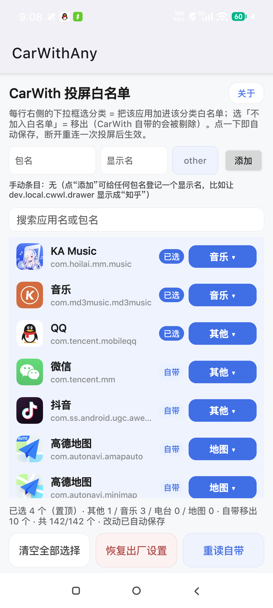
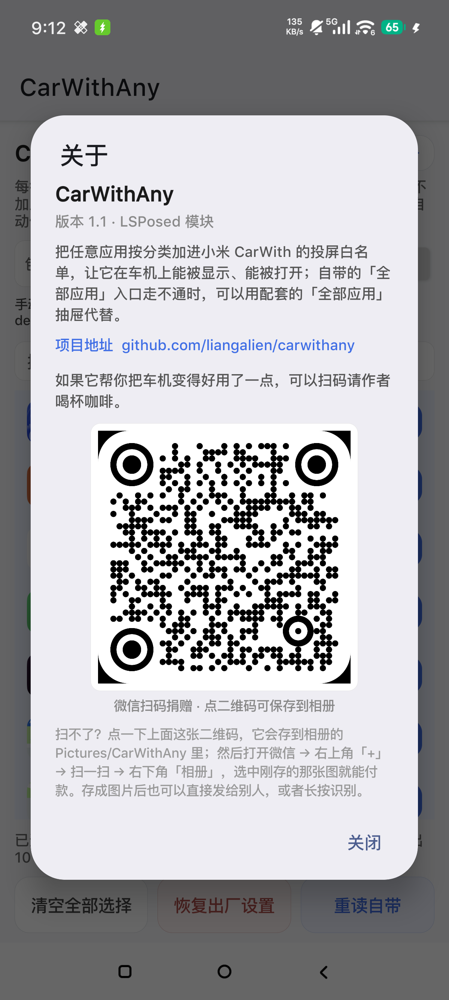
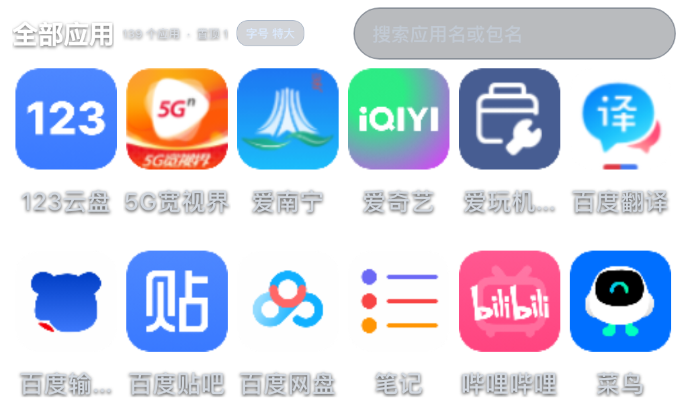
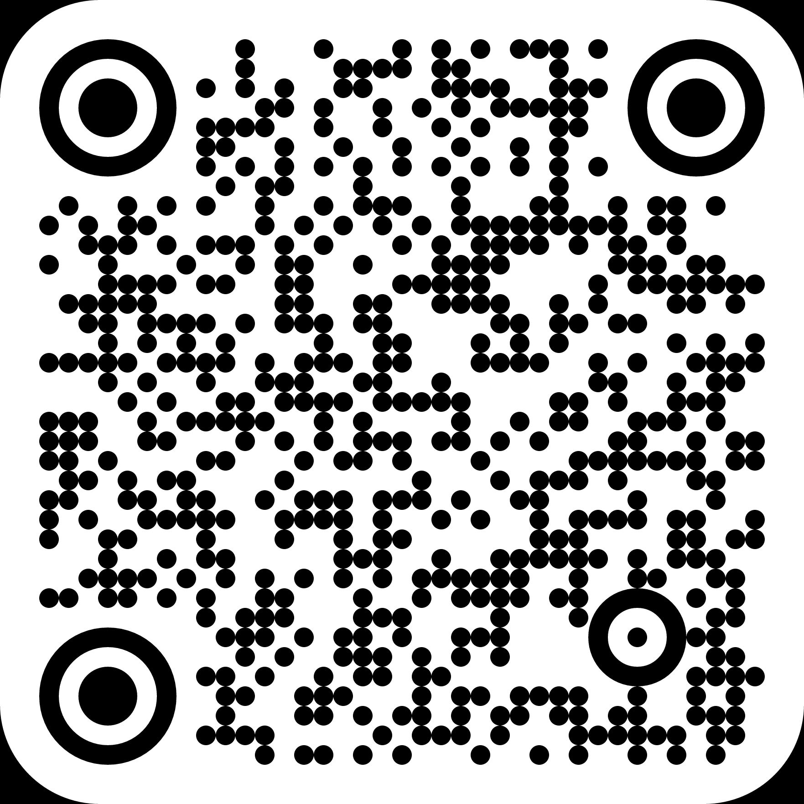

# CarWithAny

小米 **CarWith**（`com.miui.carlink`）投屏的扩展模块：把任意应用加进 CarWith 的「应用白名单」，让它在车机上能被显示、被点开。

一个 LSPosed 模块 + 一个可选的「全部应用」抽屉。测试环境为小米 CarWith `4.0.21` + Magisk + LSPosed。

| 产物 | 包名 | 说明 |
| --- | --- | --- |
| `CarWithAny-<版本>.apk` | `com.ikang.carwithany` | LSPosed 模块，同时带配置界面（就是它自己的图标进去） |
| `AllAppsDrawer-<版本>.apk` | `com.ikang.cardrawer` | 车机端的「全部应用」抽屉，横屏 6 列宫格 |



---

## 背景

CarWith 投屏到车机后，能出现在车机上的应用是**固定白名单**：`com.miui.carlink` 内部用 `AppWhiteItem(包名, minVersion, 分类, 显示名, mode)` 描述每个条目，分类只有 `other / music / radio / map / media_app` 五种，并由云控（`CloudControlBean#getAppWhiteList`）给一份额外清单。

这带来三个问题：

1. **装了的应用不出现**。白名单之外的 app 根本没有入口，想用车机屏幕刷 B 站、看小说、用某个车机版导航都不行。
2. **「全部应用」入口点不开**。CarWith 自带的那个入口会弹「全部应用版本过低，请在应用商店进行更新」，而应用商店里并没有对应更新。
3. **第三方 app 拉不起来**。车机那块屏是 CarWith 自己 `createVirtualDisplay` 出来的 **private display**，别的进程往上面 `startActivity` 会被拒或者退回手机屏；即使侥幸起来，CarWith 还会因为 `ucar_ae_projection_debug_mode` 不是 2 而拦掉跨应用跳转。

改 CarWith 自己的 prefs（`ucar_settings_added_app_sort.xml`、`file_prefer_app_*.xml`、`quick_app_sp.xml`）没用，它每次都会重写还原。所以只能从进程内部改。

## 做法

模块跟着 `com.miui.carlink` 进程跑，做四件事：

### 1. 白名单注入

hook 住产出白名单的两个入口 —— `com.carwith.common.utils.c0#s0(List)` 和 `CloudControlBean#getAppWhiteList()`，拿到原始清单后在返回前重写：

- 用户标记「移出」的包名（`mode=0`）：从清单里**无条件删掉该包名的所有条目**；
- 用户标记「加入某分类」的包名（`mode=1`）：用 `XposedHelpers.newInstance(itemCls, pkg, 0L, cat, label, 1)` 造一个新条目追加进去。`minVersion` 固定为 `0`，绕开 CarWith 的版本校验，所以随便什么应用都能塞进去。

配置数据放在模块自己的 SharedPreferences，通过 `ConfigProvider`（`content://com.ikang.carwithany.config`）暴露给 hook 进程读 —— 直接读 CarWith 的私有目录或反向读模块目录在 MIUI 上都不可靠，走 Provider 最省事。

### 2. 放行跨应用跳转

`Settings$Global#getInt("ucar_ae_projection_debug_mode")` 恒返 `2`。原本 `0` 表示「投屏应用不支持跳转」，`2` 是放行。

### 3. 替抽屉在车机屏上拉起应用

抽屉自己无法往 private display 上 `startActivity`，于是让属于 display 属主的 CarWith 进程代劳：

```
抽屉 --广播 com.ikang.cardrawer.LAUNCH {pkg, display}--> CarWith 进程里的 receiver
     -> getLaunchIntentForPackage + ActivityOptions.setLaunchDisplayId(display)
```

hook `ActivityOptions#setLaunchDisplayId` 顺便记下 CarWith 自己用的投屏屏 id（选名字含 `com.miui.carlink`、横屏、宽度最小的那个虚拟屏），抽屉广播里没带 id 时用它兜底。点击应用后抽屉自己 `finish()`，不挡住刚拉起的应用。

### 4. 抓「自带」清单

CarWith 的清单不止一处，静态逆向只能覆盖一部分（比如**微信、芒果TV、车机版音乐/导航、喜马拉雅、帆书、云听**这些都是运行时才冒出来的）。所以模块在每次重写清单时，把原始条目里的 `包名|分类` 累积起来，通过 `com.ikang.carwithany.BUILTIN` 广播回传给配置界面：

- 先按注入记录过滤掉「自己塞进去的条目」，避免用户自加的应用被误标成「自带」；
- 累积并集、最多广播 20 次，首播时把全量 `pkg|cat` 打到 `CarWithRedirect` 日志里；
- 配置界面收到后与已存清单取并集，不整体覆盖。

仓库里的离线兜底表 `src/.../BuiltinWhitelist.java` 是「静态抽取 64 条 + 运行时 71 条取并集」= **78 条**，保证模块刚装、还没连过一次投屏时，自带条目也能默认显示、默认勾上。

---

## 使用方法

### 前置条件

- 手机已 root（Magisk）并装了 **LSPosed**
- 已安装小米 CarWith（`com.miui.carlink`）

### 1. 装模块、启用

1. 安装 `CarWithAny-*.apk`。
2. 打开 **LSPosed** → 模块 → 启用 `CarWithAny`。
3. 作用域**只勾** `com.miui.carlink`（勾别的没用，反而增加崩溃风险）。
4. 强制停止 CarWith，或直接断开重连一次投屏。日志里出现 `module loaded in com.miui.carlink` 就说明生效了。

```bash
adb logcat -s CarWithRedirect:I
```

### 2. 配置界面

点开 `CarWithAny` 图标就是配置页，**一份应用列表**，每行右侧一个下拉框：

| 下拉选项 | 含义 |
| --- | --- |
| 不加入白名单 | 从白名单移出（CarWith 自带的会被删掉） |
| 其他 | 归到 `other`，**只有这类能正常点开**，见「已知限制」 |
| 音乐 | 归到 `music` |
| 电台 | 归到 `radio` |
| 地图 | 归到 `map` |
| 影音 | 归到 `media_app`（CarWith 自带清单里实际存在的第 5 类，芒果TV/斗鱼/西瓜视频就在这） |

几条约定：

- **点一下就保存生效**，不需要再点保存按钮；状态栏常驻「改动已自动保存」。
- **已选的应用自动置顶**，并且**最近选的那个排最前**，方便反复调整。
- **CarWith 自带的条目默认勾选**，右侧带浅蓝「自带」标签；取消勾选就是从白名单移除，移除后标签变红「已移除」。
- 顶部可以手动登记「包名 + 显示名 + 分类」，给 CarWith 认不出的包名补一个名字（比如让 `com.ikang.cardrawer` 显示成「知乎」）。
- 改动保存后**断开重连一次投屏**才会真正刷新到车机上（CarWith 只在拉起时读清单）。

底部三个操作：

| 按钮 | 作用 |
| --- | --- |
| 清空全部选择 | 所有分类清空，自带条目一并移出，车机上一个都不剩（带二次确认） |
| 恢复出厂设置 | 清掉自加应用、手动条目、移除记录，回到 CarWith 自带清单原样 |
| 重读自带 | 清掉缓存的 CarWith 清单，下次连投屏重新抓一份。**CarWith 升级/降级后点一次即可**，不用手动维护 |

标题右侧还有「关于」：里面是版本号、项目地址和捐赠二维码。**二维码可以直接点，点一下会存到相册的 `Pictures/CarWithAny/`**，然后在微信里用「扫一扫 → 相册」选中它就能付款（存成图片后也能直接发给别人或长按识别）。



### 3. 「全部应用」抽屉（可选）

CarWith 自带的「全部应用」有版本校验过不去，用自己的抽屉替代：

1. 装 `AllAppsDrawer-*.apk`；
2. 在配置界面里把它（`com.ikang.cardrawer`）加进「其他」分类；
3. 重连投屏，CarWith 的「投屏应用管理」/车机首屏里就会出现它，点开就是横屏 6 列的全部应用宫格，顶部可按名称或包名搜索，长按可置顶，点一下应用就在车机屏打开并自动退出。



### 4. 命令行 / 脚本化（进阶）

配置改不了界面时（例如远程调试、批量恢复）可以直接走广播和 Provider：

```bash
# 把某个应用加进「音乐」，cat 取 other/music/radio/map/media_app，none = 移出
adb shell am broadcast -a com.ikang.carwithany.SET \
  -n com.ikang.carwithany/.BuiltinReceiver --es pkg com.example.app --es cat music

# 清空：rm = 清全部选择，all = 恢复出厂，builtin = 重读自带
adb shell am broadcast -a com.ikang.carwithany.SET \
  -n com.ikang.carwithany/.BuiltinReceiver --es clear all

# 核对当前配置真值 / 已抓到的自带清单
adb shell content query --uri content://com.ikang.carwithany.config/extra
adb shell content query --uri content://com.ikang.carwithany.config/builtin
```

> MIUI 的 Greezer 会拦截发给后台应用的广播（日志里会出现 `Greezer Denial ... need cached broadcast`）。先把 `CarWithAny` 拉到前台（`am start -n com.ikang.carwithany/.ConfigActivity`）再发广播就不会被拦。

车机上真正生效前同样需要重连一次投屏；也可以直接让 CarWith 重建清单：

```bash
adb shell "su -c 'am start -n com.miui.carlink/com.carwith.launcher.home.HomeActivity'"
```

---

## 编译

构建链路不依赖 Gradle，纯命令行：`javac(11) → jar → d8(min-api 29) → aapt2 link → 合并 classes.dex → zipalign → apksigner`。Xposed API（`libs/api-82.jar`，已随仓库提供）找不到时会自动下载。

版本号的**唯一来源**是仓库根的 `version.properties`：

```properties
VERSION_NAME=1.0
VERSION_CODE=1
```

### Windows 本地

```powershell
pwsh -File .\build.ps1            # 只出包，产物在 out\
pwsh -File .\build.ps1 -Install   # 出包并 adb install -r 到已连的手机
```

需要 `ANDROID_HOME`（默认取 `D:\soft\Android\SDK`，含 build-tools 36.0.0 与 platforms/android-36）、JDK 11+（默认取 `$env:JAVA_HOME`）、python3。可用环境变量覆盖：`ANDROID_HOME`、`BUILD_TOOLS_DIR`、`JAVA_HOME`、`VERSION_NAME`、`VERSION_CODE`、`KEYSTORE`、`KS_PASS`、`KEY_PASS`、`KEY_ALIAS`，连接设备用 `-Device <ip:port>`。

### Linux / macOS

```bash
./build.sh
VERSION_NAME=1.2.0 VERSION_CODE=10200 ./build.sh
```

### GitHub Actions 自动出包

`.github/workflows/release.yml`：push 形如 `v1.2.0` 的 tag 时自动编译并创建 Release（附两个 APK）；也可以在 Actions 页面手动触发（可选填版本号、可选顺手发 Release），手动触发不填版本号就用 `version.properties`，产物同时上传为 artifact。

```bash
git tag v1.2.0
git push origin v1.2.0
```

`versionCode` 不填时按 `主*10000 + 次*100 + 修` 推导（`1.2.0 → 10200`）。

**签名**：默认用仓库内 `keystore/debug.keystore`（标准 debug key，口令 `android` / 别名 `androiddebugkey`），这样 CI 出来的包和本地 debug 安装的包**签名一致，可以原地覆盖升级**。想换成自己的证书，就在仓库 Secrets 里配置：

| Secret | 说明 |
| --- | --- |
| `SIGNING_KEYSTORE_BASE64` | keystore 的 base64（`base64 -w0 my.jks`） |
| `SIGNING_KEYSTORE_PASSWORD` | keystore 口令 |
| `SIGNING_KEY_PASSWORD` | key 口令，留空则与上面相同 |
| `SIGNING_KEY_ALIAS` | key 别名 |

配了就会覆盖内置 debug key，此时第一次安装新证书的包需要先卸载旧包。

---

## 目录结构

```
├── AndroidManifest.xml          模块清单（xposedmodule / ConfigActivity / Provider / Receiver）
├── assets/xposed_init           LSPosed 入口类
├── src/com/ikang/carwithany/
│   ├── RedirectHook.java        hook：白名单注入、调试模式恒 2、代拉抽屉、自带清单回传
│   ├── ConfigActivity.java      配置界面（单列表 + 行内下拉 + 三个底部操作）
│   ├── ConfigProvider.java      content:// provider，向 hook 暴露配置与自带清单
│   ├── ConfigStore.java         无界面写入（广播改配置用）
│   ├── BuiltinReceiver.java     接收 BUILTIN（自带清单回传）与 SET（脚本化改配置）
│   ├── BuiltinWhitelist.java    离线兜底自带清单（78 条，生成物）
│   └── BuiltinJson.java         自带清单 JSON 的解析/序列化
├── res/, libs/api-82.jar        资源与 Xposed API
├── drawer/                      「全部应用」抽屉（独立 APK）
├── scripts/                     白名单抽取/生成脚本与数据
│   ├── extract_builtin.py       从反编译产物里抽静态清单
│   ├── gen_builtin.py / gen_builtin2.py  生成 BuiltinWhitelist.java
│   ├── builtin_extracted.json   静态抽取结果（64 条）
│   ├── runtime_builtin.txt      运行时抓到的清单（71 条）
│   └── builtin_whitelist.txt    并集后的 78 条（pkg|cat）
├── keystore/debug.keystore      默认签名（仅供本地/CI 出包）
├── version.properties           版本号唯一来源
├── build.ps1 / build.sh         本地构建
└── .github/workflows/release.yml
```

## 维护自带清单

CarWith 换大版本（或你发现某个「自带」应用没被标出来）时：

1. 车机上重连一次投屏，让模块抓一遍；
2. `adb shell content query --uri content://com.ikang.carwithany.config/builtin > runtime_builtin.txt`；
3. 用 `scripts/gen_builtin2.py` 把静态抽取结果与运行时结果取并集，重生成 `BuiltinWhitelist.java`；
4. 重新编译。

平时不需要这么做：运行时清单是现抓的，且「重读自带」按钮可以让它按当前版本重新抓 —— 升级后自带条目会变多、降级后残留的旧条目也会被清掉。

## 已知限制

- **只有 `other` 分类的应用能正常点开**。`music` / `radio` 分类 CarWith 会走媒体集成（去绑 `MediaBrowserService`），塞进去的普通应用点了打不开；`map` 需要应用自己支持车机导航协议。
- 冒名白名单里已安装的应用（云听、网易云、小米音乐等）会因签名不符 `INSTALL_FAILED_UPDATE_INCOMPATIBLE`；装低版本会撞 `VERSION_DOWNGRADE`。
- CarWith 的清单是云端 + 内置混合，不同机型/版本给到的条目不一样；「自带」标记以运行时抓到的为准，离线表只是兜底。
- 模块自身跑在 CarWith 进程里，CarWith 崩溃时日志只能看 `CarWithRedirect`；改完配置必须重连投屏才生效（CarWith 不会实时重读）。
- 抽屉用的是 `com.ikang.cardrawer` 这个自造包名，如果哪天 CarWith 把它当未知包过滤掉，需要在配置界面手动给它登记显示名（或改用白名单内的包名）。
- 车机端的最终显示名/图标由 CarWith 决定，模块只能控制「是否出现」和「归到哪个分类」。

## 捐赠

如果这个模块帮你把车机变得好用了一点，可以扫码请作者喝杯咖啡。




## 许可

GPL-3.0，见 [LICENSE](LICENSE)。
